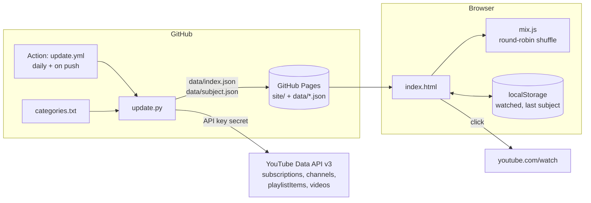

# Subject Mixer

Watch YouTube by subject (wine, travel, history…) with variety: pick a subject and get a shuffled mix
from every channel in it, dealt round-robin so no single channel takes over.

**Site:** https://noamros9.github.io/youtube-mixer/

## How it works

- Every day a GitHub Action reads the (public) subscription list of channel `UC6hRgPgs1xo-LEreFdrHOqw`,
  pulls each channel's latest 100 uploads, drops anything under 3 minutes (Shorts, trailers), and deploys
  the page with one data file per subject.
- Subjects live in [`categories.txt`](categories.txt): `Subject: handle handle …`. A channel can be in
  several subjects. New subscriptions not listed there appear under **New / Unsorted** until added.
- Watched videos are remembered per browser (localStorage), not synced between devices.

**Install as an app:** open the site in Chrome → Install icon at the right of the address bar
(or ⋮ → Cast, save and share → Install page as app).

## Change things

- **Move or add a channel:** edit `categories.txt` and push. The site rebuilds on every push.
- **Refresh now:** Actions → *Update and deploy* → *Run workflow*.
- **Run locally:** put `YOUTUBE_API_KEY=…` in `.env`, then
  `python update.py && python -m http.server -d site 8765` and open http://127.0.0.1:8765.
- **Tests:** `python test_update.py && node --test site/mix.test.mjs`

Setup: the repo secret `YOUTUBE_API_KEY` (a YouTube Data API v3 key, project `youtube-mixer-514119`)
and Pages source set to *GitHub Actions*.

## Architecture

